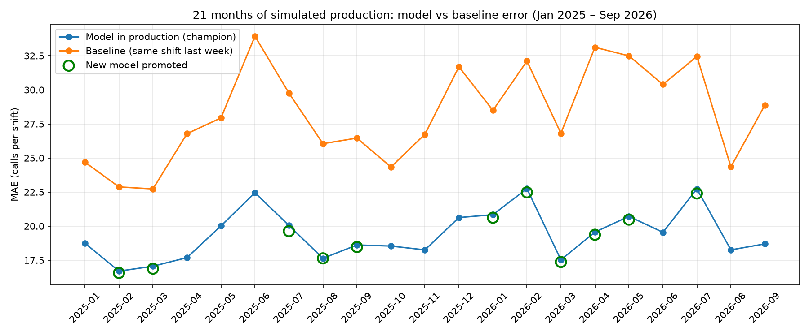
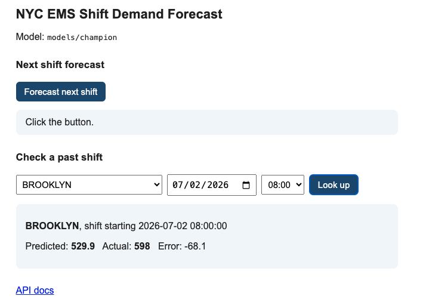

# NYC EMS Shift Demand Forecasting: An MLOps Pipeline


## Overview

**The question:** *How many EMS calls should each NYC borough expect in its next 8-hour shift, and can a model stay accurate as demand changes over time?*

NYC's ambulance system answers more than 4,000 calls a day, and demand rises and falls by hour, weekday, season, and borough. Staffing too few crews means slower response times; too many wastes resources. A reliable short-term forecast helps planners match crews to demand.

This project answers three questions:

1. **Can a machine learning model beat a simple rule of thumb** ("expect the same as this shift last week")?
2. **Can the model stay accurate over time**, as seasons change and demand shifts, with automated retraining?
3. **Where does the model fail, and why?**

**The data:** about 6 million EMS dispatch records (January 2023 to September 2026) from NYC Open Data, counted by borough and hour, then grouped into 8-hour shifts.

**The short answer:** yes, the model's error was about 31% lower than the rule of thumb in every one of 21 simulated months. Its biggest misses came on extreme heat days, when demand spiked beyond anything the calendar and recent history could predict.

## What I Built

An end-to-end machine learning pipeline that forecasts **NYC ambulance (EMS) call volume for each borough and 8-hour shift**, so planners can staff the right number of crews. The pipeline downloads public data, validates it, builds features, trains and compares models in **MLflow**, promotes a new model only when it beats the current one, and serves forecasts through a **FastAPI** dashboard packaged in **Docker**.

I built it to learn MLOps hands-on: not just training a model, but keeping one accurate and running over time.

---

---

## Headline Result

I replayed **21 months of simulated production** (January 2025 to September 2026). Each month, new data "arrived," the current model was scored, a challenger was retrained, and the better model was kept.

| Metric | Result |
| --- | --- |
| Average error of the model in production (MAE) | **19.4 calls per shift** |
| Average error of the baseline ("same shift last week") | 28.2 calls per shift |
| Improvement over baseline | **~31% lower error** |
| Months the model beat the baseline | **21 of 21** |
| Months a retrained model was promoted | 11 of 21 |



---

## The Problem

FDNY EMS answers over **4,000 calls a day** across five boroughs, and demand changes by hour, weekday, and season. A reliable forecast of calls for the **next shift** helps decide how many ambulances and crews to schedule.

- **Target:** total EMS calls per borough per 8-hour shift (12am–8am, 8am–4pm, 4pm–12am)
- **Shift length is a setting:** FDNY uses both 8-hour and 12-hour tours, so `shift_hours` in `config.yaml` can be switched to 12 without code changes.

## The Data

- **Source:** [NYC Open Data, EMS Incident Dispatch Data](https://data.cityofnewyork.us/Public-Safety/EMS-Incident-Dispatch-Data/76xm-jjuj) (dataset `76xm-jjuj`)
- **Period used:** January 2023 to September 2026 (about 6.07 million calls)
- **Efficient download:** instead of downloading millions of raw rows, the pipeline asks the API to **count calls by borough and hour** (SoQL `GROUP BY`). Each month is about 3,700 rows instead of about 130,000.
- **No external data:** features come only from the call history and the calendar. Weather was left out on purpose (see Limitations).

---

## How the Pipeline Works

```
NYC Open Data API
   → download.py   (monthly hourly counts)
   → data.py       (clean + validate)
   → features.py   (shifts, calendar, lags)
   → train.py      (baseline, Prophet, XGBoost)
   → MLflow        (tracking + model registry)
       ├─ replay.py  (monthly retrain + promote)
       └─ api.py     (FastAPI dashboard) → Docker
```

| Step | File | What it does |
| --- | --- | --- |
| Settings | `config.yaml` | All settings in one place: dates, boroughs, shift length, MLflow names, drift threshold |
| Download | `src/download.py` | Pulls one month at a time from the API, already counted by borough and hour; skips months already downloaded |
| Clean & validate | `src/data.py` | Fixes types, fills hours with no calls as 0, drops UNKNOWN boroughs, and **stops the pipeline** if anything looks wrong (missing hours, duplicates, negative counts, a borough with no calls, or more than 1% of calls lost in cleaning) |
| Features | `src/features.py` | Groups hours into shifts; adds calendar features (shift, weekday, weekend, month, US holidays) and history features (previous shift, same shift yesterday, same shift last week, 7- and 28-day averages) |
| Train | `src/train.py` | Trains a baseline, Prophet, and XGBoost on the same data and logs every run to MLflow |
| Evaluate | `src/evaluate.py` | Saves the model to the **MLflow Model Registry** and moves the `champion` label to a new model **only if its error is lower** on the same unseen month |
| Replay | `src/replay.py` | Simulates 21 months of production: monitor, check drift, retrain, promote or keep |
| Serve | `src/api.py` | FastAPI service with a simple dashboard: next-shift forecast and past-shift lookup (predicted vs actual) |
| Package | `Dockerfile` | Runs the API anywhere with the exported champion model |
| Test | `tests/`, `.github/workflows/` | 16 pytest tests, run automatically on every push with GitHub Actions |

### Key design decisions

- **One model for all boroughs.** All five boroughs share the same daily and seasonal shape (see the EDA), so one model with a borough feature learns from 5x more data. This also matched my earlier daily-forecast project, where the combined model beat separate ones.
- **No leakage.** Every history feature uses only shifts that have already finished. A test plants an extreme value in a shift and checks it doesn't leak into that shift's own rolling average.
- **Lags are computed within each borough**, so one borough's numbers never feed another's features (also covered by a test).
- **Time-based evaluation only.** Models are always tested on months they never saw, never on a random split.
- **Champion vs challenger.** A retrained model replaces the current one only if it's strictly better on the same month, so a tie keeps the existing model.

---

## Results and Findings

### Model comparison (train 2023–2024, test January 2025)

| Model | MAE (calls per shift) |
| --- | --- |
| **XGBoost (global, with lag features)** | **18.8** |
| Baseline (same shift last week) | 24.7 |
| Prophet (one model per borough) | 26.2 |

XGBoost beat the baseline in **every borough**. Prophet did worse than the baseline, especially in the Bronx, where demand shifted upward in late 2024: Prophet follows a long-term trend, while XGBoost adapts through recent-history features.

### What the data showed (see `notebooks/01_eda.ipynb`)

- Calls bottom out around **4–5am**, rise sharply until about 10am, and stay high until early evening.
- **Weekends are 4–7% quieter** than weekdays (Sunday lowest).
- There's a **summer peak** and a smaller **December bump**.
- **Manhattan is the hardest large borough to predict**, likely because its daytime population changes with commuters and visitors. Staten Island has the highest relative error, since its small counts are noisy.
- The **quietest days are Thanksgivings** (about 20% below normal).
- The **busiest days match heat waves**: June 23–25, 2025, and July 2–3, 2026.

### Where the model struggles: heat waves



The dashboard makes the limitation easy to see:

| Brooklyn, 8am–4pm shift | Predicted | Actual | Miss |
| --- | --- | --- | --- |
| June 10, 2026 (normal summer day) | 532 | 534 | 0.4% |
| July 2, 2026 ([100°F in Central Park](https://www.weather.gov/okx/20260703), hottest day in about 14 years) | 530 | 598 | 11% |

On the same heat day, the Bronx day shift was underpredicted by about 18%, so heat raises demand **unevenly across boroughs**. Without weather data, the model treats a heat wave like an ordinary summer day.

### What the replay showed

- Retraining every month helped only a little (about 0.1–0.4 MAE per promotion); some champions stayed in production for four months. The model is stable, so **quarterly retraining** may be enough.
- The 10% drift check never fired: normal seasonal swings were 4–9%. Staten Island's noisy counts often showed the largest swings, which suggests a per-borough or error-based drift check would be sharper.

---

## Limitations

- **No weather data.** Heat waves cause the largest errors.
- **Daylight saving time.** On the spring-forward day, the missing 2am hour is recorded as 0 calls, and on the fall-back day two 1am hours are combined. That's two odd hours a year, known and documented.
- **Data published in batches.** NYC Open Data doesn't update in real time, so production is simulated by replaying past months.
- **Model registered every month.** For learning, every challenger is registered; a production setup would register only winners.

## Future Improvements

- A **forecast-based heat warning flag** (using forecast temperature, not actual, to avoid leakage), possibly with borough-specific effects
- Test the **holiday flag**, **12-hour shifts**, and shift boundaries offset by an hour as MLflow experiments
- **Quarterly retraining** and per-borough or error-based drift checks
- Move the pipeline to **AWS SageMaker** (S3, training jobs, Model Registry, batch transform, scheduled retraining, Model Monitor)

---

## How to Run It

```bash
# 1. Install
pip install -r requirements.txt

# 2. Run the pipeline
python -m src.download        # download monthly data (about 1 minute)
python -m src.data            # clean and validate
python -m src.features        # build features
python -m src.train           # train and compare models in MLflow
python -m src.evaluate        # register the first champion
python -m src.replay          # replay 21 months of production

# 3. View experiments
mlflow ui --backend-store-uri sqlite:///mlflow.db --port 5000

# 4. Serve forecasts
uvicorn src.api:app --port 8000     # dashboard at http://localhost:8000, API docs at /docs

# 5. Run the tests
python -m pytest -v
```

### Run the API with Docker

```bash
python -m src.export_model          # export the champion model to models/champion/
docker build -t ems-api .
docker run -p 8000:8000 ems-api
```

## Project Structure

```
nyc-ems-demand-pipeline/
├── config.yaml              # all settings
├── requirements.txt         # pipeline packages
├── requirements-api.txt     # smaller package list for the Docker image
├── Dockerfile
├── src/
│   ├── download.py          # API download, one file per month
│   ├── data.py              # cleaning and validation
│   ├── features.py          # shifts, calendar, lag and rolling features
│   ├── train.py             # baseline, Prophet, XGBoost + MLflow tracking
│   ├── evaluate.py          # model registry and promote-if-better rule
│   ├── replay.py            # 21-month simulated production
│   ├── export_model.py      # export the champion for Docker
│   └── api.py               # FastAPI service and dashboard
├── notebooks/
│   ├── 01_eda.ipynb         # exploratory analysis
│   └── 02_replay_results.ipynb
├── tests/                   # pytest tests
└── .github/workflows/       # GitHub Actions
```

## Tech Stack

Python, pandas, XGBoost, Prophet, scikit-learn, MLflow (tracking and Model Registry), FastAPI, Docker, pytest, GitHub Actions, NYC Open Data (Socrata API)

---

**Author:** MD A Rahman Ruhel · [LinkedIn](https://linkedin.com/in/rahmanruhel) · [GitHub](https://github.com/RuhelHaq)
